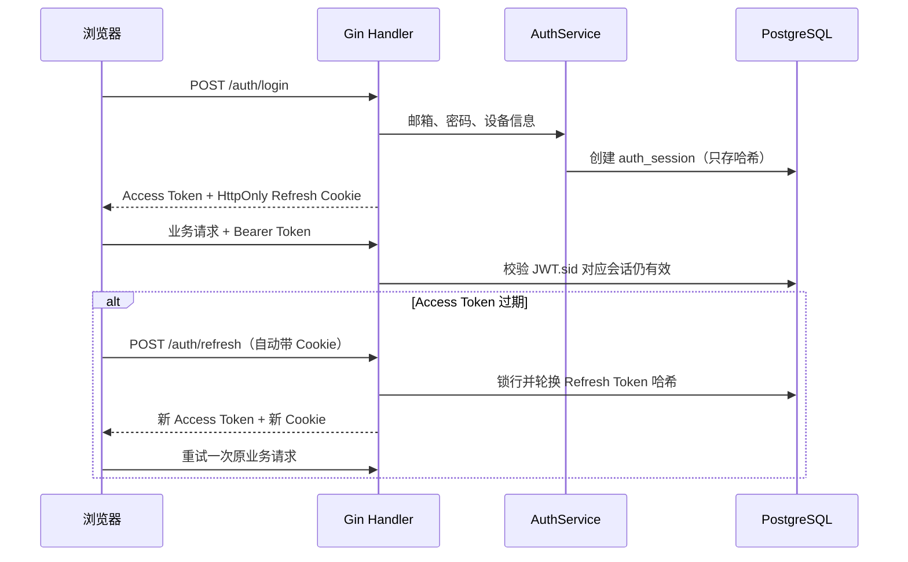

# 完整账号生命周期实现解析

本文对应 [TODO 第 7 项](../TODO.md)，目标不是“能登录就够了”，而是让凭据从签发、刷新、撤销、找回到账号注销都具备清晰的安全边界。

## 1. 为什么需要 Access Token 和 Refresh Token

只有一个有效期很长的 JWT 时，服务端通常无法在它过期前主动撤销。用户点击退出、修改密码或发现账号泄露后，旧 JWT 仍可能继续访问接口。

本项目把凭据拆成两层：

| 凭据 | 默认有效期 | 保存位置 | 用途 |
| --- | --- | --- | --- |
| Access Token | 15 分钟 | 浏览器内存和 `localStorage` 会话对象 | 携带在 `Authorization: Bearer` 中访问业务 API |
| Refresh Token | 30 天 | HttpOnly、SameSite=Lax Cookie | 仅用于换取新的 Access Token |

Access Token 的 JWT Claims 增加 `sid`，指向数据库中的设备会话：

```text
sub = user_id
sid = auth_sessions.id
exp = 当前时间 + ACCESS_TOKEN_TTL
```

鉴权中间件不仅验证 JWT 签名和过期时间，还查询 `auth_sessions` 是否未撤销且未过期。因此设备退出、全部退出和修改密码可以让尚未过期的 Access Token 立即失效。代价是每个鉴权请求多一次数据库查询；高流量生产环境可以用短 TTL Redis 缓存，但撤销时必须同步失效缓存。

## 2. Refresh Token 为什么要轮换并只保存哈希

Refresh Token 是 32 字节密码学随机数，服务端只在 Cookie 中返回原值，PostgreSQL 保存 SHA-256 哈希：

```text
浏览器 raw token ──SHA-256──> auth_sessions.refresh_token_hash
```

刷新时 Repository 在事务中对会话行加 `FOR UPDATE` 锁：

1. 用旧 Token 哈希找到未撤销、未过期的会话；
2. 生成新 Token；
3. 原子替换数据库哈希并更新 `last_used_at`；
4. 返回新的 Cookie 和 Access Token。

旧 Refresh Token 立即失效，并发刷新也只有一个请求能成功。前端用共享的 `refreshPromise` 合并同一时刻的多个 401，避免多个请求拿同一旧 Cookie 互相竞争。

> 哈希不能阻止攻击者直接重放已经窃取的原始 Token；它保护的是数据库泄露后无法直接拿哈希登录。轮换和撤销负责缩短重放窗口。

## 3. 登录、刷新和退出链路



退出相关接口的语义不同：

- `POST /auth/logout`：根据 Refresh Token 哈希撤销当前设备会话；即使 Token 已无效也幂等返回成功。
- `DELETE /auth/sessions/:id`：撤销指定设备；撤销当前设备时同时清 Cookie。
- `POST /auth/logout-all`：撤销当前用户全部会话。
- 修改或重置密码：更新密码哈希的同一数据库事务里撤销全部会话。

前端退出时即使后端暂时不可达，也会清理本地 Access Token，避免失效身份继续显示；服务端撤销失败会被结构化日志记录。

## 4. 邮箱验证与密码找回

邮箱验证和密码重置共用 `account_tokens`，但通过 `purpose` 严格区分。Token 同样只保存哈希，并记录过期时间和 `used_at`。

- 注册后创建邮箱验证 Token，默认 24 小时有效；重新发送会使同用途旧 Token 失效。
- 忘记密码创建重置 Token，默认 30 分钟有效。
- 消费 Token 时使用行锁，校验用途、过期和使用状态，并在事务中标记已使用。
- 重置密码时“消费 Token、更新密码、撤销全部会话”是同一事务，不能出现密码已经改了但旧设备仍有效的中间状态。

忘记密码接口无论邮箱是否存在都返回相同文案，邮件发送失败也不会向调用方暴露差异，防止攻击者枚举注册邮箱。开发环境默认 `EMAIL_DELIVERY_MODE=log`，验证/重置链接会写入后端日志；生产环境使用 `smtp`，并配置发件地址和 SMTP 凭据。

## 5. 频率限制

登录、注册、忘记/重置密码使用 Redis 固定窗口限流。Key 由动作加“IP + 邮箱或 Token 哈希”的 SHA-256 组成，Redis 中不出现明文邮箱：

```text
auth:<action>:sha256(identity)
```

超限返回 HTTP `429` 和 `Retry-After`。Redis 临时异常时当前实现选择 fail-open，并记录错误日志，避免 Redis 故障让所有用户无法登录；更高安全等级部署可以改成登录 fail-closed、找回流程 fail-open的分级策略。

固定窗口实现简单，但窗口边界可能允许短时突发。需要更平滑控制时可改为滑动窗口或令牌桶，而不改变 `ratelimit.Limiter` 接口。

## 6. 设备会话与审计

`auth_sessions` 一行代表一个浏览器/设备，记录：设备名、User-Agent、创建时间、最近刷新时间、绝对过期时间和撤销原因。列表接口只返回当前仍有效的会话，并明确标出当前设备。

关键操作写入 `account_audit_logs`，例如注册、登录、刷新、退出、邮箱验证、密码重置、导出和注销。审计表不与用户表建立外键，账号删除后仍能按配置期限保留安全事件；其中不保存邮箱、密码、原始 Token 或对话内容。应用启动时会清理过期凭据，并按 `AUTH_CREDENTIAL_RETENTION_DAYS` 清理较早的已撤销会话和已使用一次性 Token。

## 7. 数据导出和注销

`GET /account/export` 下载 JSON，包含用户可拥有的数据，但通过模型 `json:"-"` 排除密码哈希、Token 哈希、对象存储 Key 和内部缓存。

`DELETE /account` 必须同时提交当前密码和固定确认文本 `DELETE`。服务先删除对象存储文件，再删除用户记录，PostgreSQL 外键级联清理会话、一次性 Token、对话、消息、附件元数据和摘要版本。详细边界见 [用户数据保留与删除策略](./data-retention-policy.md)。

## 8. 代码导航

| 层 | 主要文件 | 职责 |
| --- | --- | --- |
| Auth 基础 | `backend/internal/auth/auth.go` | bcrypt、JWT、随机 Token 与哈希 |
| Model | `backend/internal/database/model/auth_session.go` 等 | 设备会话、一次性 Token、审计表 |
| Repository | `backend/internal/repository/auth.go` | 行锁、事务、导出和级联删除入口 |
| Service | `backend/internal/service/auth.go` | 账号生命周期业务规则与审计编排 |
| Handler/Router | `backend/internal/httpapi/handler/auth.go`、`router.go` | Cookie、状态码和路由 |
| Middleware | `backend/internal/httpapi/middleware/auth.go` | JWT + 会话状态双重校验 |
| Mail/限流 | `backend/internal/mailer`、`ratelimit` | 邮件投递抽象与 Redis 限流 |
| Frontend | `frontend/src/components/AuthPanel.vue`、`AccountPanel.vue` | 登录/找回流程与账户安全中心 |

## 9. 本地验证

1. 保持 `EMAIL_DELIVERY_MODE=log` 并启动后端。
2. 注册后从后端日志复制 `verifyToken` 链接，验证邮箱。
3. 登录两个浏览器或无痕窗口，在“账户与安全”撤销其中一个设备，确认其下一次 API 请求收到 401。
4. 点击忘记密码，从日志打开 `resetToken` 链接；重置后确认所有旧设备都需要重新登录。
5. 导出 JSON，确认不包含 `passwordHash`、`refreshTokenHash` 和对象存储内部 Key。
6. 注销测试账户，确认 PostgreSQL 业务数据和 MinIO 对象被清理，但安全审计按保留策略存在。

自动化验证命令：

```bash
cd backend && go test ./...
cd frontend && npm test && npm run build
```

## 10. 仍可继续加强的生产能力

- 将安全审计/过期 Token 清理改为周期任务，并增加失败指标和告警。
- 识别 Refresh Token 重用：若已轮换的旧 Token 再次出现，撤销该 Token 家族的全部会话。
- 增加 MFA、异常登录检测、IP/地理位置提示和高风险操作二次确认。
- 使用邮件模板服务、投递状态回调和退信处理。
- 对 Access Token 会话校验增加可撤销的 Redis 短缓存，降低数据库压力。
- 用后台删除任务和幂等 Saga 协调 PostgreSQL、对象存储与备份删除。
