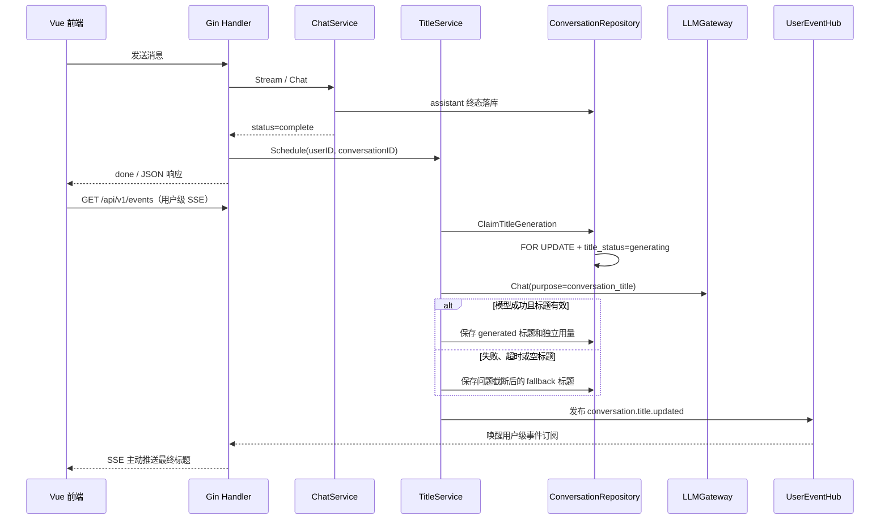

# 自动生成对话标题实现解析

本文讲解 TODO P0 第 4 项“自动生成对话标题”的实现。它看起来只是一次额外的模型调用，实际还需要处理异步执行、并发幂等、用户手动改名保护、失败降级、文本清洗和独立成本核算。

## 1. 产品目标

新建对话初始名称为 `New conversation`。首个 assistant 回答成功落库后，服务端异步生成简短标题：

- 标题生成不延迟回答的 `done` 事件；
- 模型失败、超时或限流时，使用首条问题生成降级标题；
- 用户手动改名后，后台结果永远不能覆盖用户标题；
- 标题不能包含换行、Markdown、模型前缀或多余引号；
- 标题调用单独记录 Provider、模型、Token 和成本；
- 重复完成通知不会重复调用标题模型。

旧版本由前端在消息刚发送时截断首条内容并调用重命名接口。该方案发生得太早，也会让服务端误以为这是用户手动标题。本次实现删除了前端抢跑逻辑，把标题生命周期收口到后端。

## 2. 标题状态机

`conversations.title_status` 保存标题生命周期：

```mermaid
stateDiagram-v2
    [*] --> default: 新建空标题会话
    default --> generating: 首个成功回答后领取任务
    generating --> generated: 模型标题清洗成功
    generating --> fallback: 模型失败或结果为空
    default --> manual: 用户手动改名
    generating --> manual: 生成期间手动改名
    generated --> manual: 自动标题后手动改名
    fallback --> manual: 降级标题后手动改名
```

终态包括 `generated`、`fallback` 和 `manual`。只有 `default`，或者租约已过期的 `generating`，才允许再次领取任务。

会话表同时保存：

| 字段 | 作用 |
| --- | --- |
| `title_provider` / `title_model` | 实际执行标题任务的模型 |
| `title_input_tokens` / `title_output_tokens` | 标题调用输入、输出 Token |
| `title_total_tokens` | 标题调用总 Token |
| `title_usage_reported` | 供应商是否返回真实用量 |
| `title_cost_nano_usd` / `title_cost_known` | 标题成本及其是否有效 |
| `title_generation_started` | 任务领取时间，用于识别陈旧任务 |
| `title_generated_at` | 自动或降级标题完成时间 |

这些字段不混入 assistant 消息用量，因此“回答成本”和“标题成本”可以分别统计。

## 3. 完整调用链路



标题只在 assistant 的业务状态为 `complete` 时调度。`stopped`、`interrupted` 和 `error` 不会触发；如果用户后续重新生成并第一次得到成功回答，那次完成通知仍可领取标题任务。

## 4. 为什么使用 Repository 原子领取

流式连接可能重连，HTTP 层也可能重复通知完成。如果只使用内存布尔值，多实例部署或进程重启后仍会重复调用模型。

`ClaimTitleGeneration` 在数据库事务中：

1. 使用 `SELECT ... FOR UPDATE` 锁定会话；
2. 检查标题状态；
3. 找到最早成功 assistant 及其 `reply_to_message_id` 对应的问题；
4. 更新为 `generating` 并记录开始时间；
5. 提交事务后才调用模型。

因此并发任务中只有一个能领取成功。模型调用不能放在数据库事务中，否则外部网络等待会长时间占用数据库行锁和连接。

`generating` 具有租约语义：开始时间超过 `max(2 × TITLE_GENERATION_TIMEOUT, 1 分钟)` 后可以重新领取，用于修复进程在调用期间崩溃造成的永久卡住。

## 5. 手动改名为什么不会被覆盖

手动重命名使用单条原子更新，同时写入标题、`title_status=manual` 并清空任务开始时间。

模型返回后，`CompleteTitleGeneration` 再次锁定会话，并且只在状态仍为 `generating` 时更新。如果用户已经改名为 `manual`，模型结果会被忽略。

这里不能使用“先查询，再 Save 整行”。否则手动请求可能拿着旧快照，在标题任务保存用量后覆盖整行，把刚写入的 Token 和成本重置为零。当前实现只更新手动标题相关字段，不会抹掉并发写入。

## 6. 模型选择与配置

默认复用首个成功回答的 Provider 和模型。也可以路由到独立小模型：

```dotenv
TITLE_GENERATION_PROVIDER=deepseek
TITLE_GENERATION_MODEL=deepseek-chat
TITLE_GENERATION_MAX_TOKENS=64
TITLE_GENERATION_MAX_LENGTH=40
TITLE_GENERATION_TIMEOUT=15s
```

Provider 和 Model 必须同时为空或同时配置，启动时会校验是否已启用。独立模型可以降低成本，但首轮问题和回答会发送给另一个供应商，生产部署需要评估数据驻留和隐私要求。

标题请求包含：

- system：要求只返回标题、保持用户语言，不输出解释或 Markdown；
- user：首个成功问答的问题和回答；
- `MaxOutputTokens`：默认 64，避免生成长段落；
- `Purpose=conversation_title`：让 LLMGateway 日志能区分标题与普通对话。

问题和回答各自最多保留约 2000 个字符，避免标题任务因超长首轮内容产生不必要成本。

## 7. 标题清洗与失败降级

即使 Prompt 要求只返回标题，模型仍可能返回：

```text
## 标题：**Go Agent 入门**
```

`sanitizeConversationTitle` 会：

1. 将 Markdown 链接转换成可见文本；
2. 删除换行、反引号、标题符号和强调符号；
3. 合并连续空白；
4. 去掉 `Title:`、`标题：`、`对话标题：` 等前缀；
5. 去掉首尾引号和标点；
6. 按 Unicode 字符限制最终长度。

模型失败、超时、被限流或清洗后为空时，会用相同规则清洗对应的用户问题并保存为 `fallback`。问题也为空时保留 `New conversation`，但状态仍成为 `fallback`，不会无限重试和重复计费。

模型超时后原请求上下文已经失效，因此标题终态使用独立、最多 5 秒的数据库收尾上下文保存降级结果，避免会话永久停在 `generating`。

## 8. 用户级 SSE 如何通知浏览器

回答的 `done` 不等待标题模型，所以消息级 SSE 会正常结束。浏览器登录后另外建立一条受 JWT 保护的长连接：

```http
GET /api/v1/events?afterSequence=12
Authorization: Bearer <token>
Accept: text/event-stream
```

标题事务提交后，`TitleService` 向用户事件 Hub 发布：

```text
id: 13
event: conversation.title.updated
data: {"conversation":{"id":"...","title":"Go Agent 入门","titleStatus":"generated"},"sequence":13}
```

Hub 按用户隔离事件，其他用户不能订阅该标题；每个用户使用独立递增序号和短期历史。前端记录最后的 sequence，断线后携带它重连，服务端只补发更大的事件。连接每 15 秒发送注释心跳，前端网络失败时使用最大 5 秒的指数退避自动重连。

如果缓存已经截断、服务重启导致序号归零，服务端返回 `409` 或发送 `stream.reset`。前端此时重新加载会话列表作为权威快照，再从序号 0 建立新连接。这样不会为了追求事件连续而保留错误的本地状态。

## 9. 旧数据迁移

旧版本中标题不等于 `New conversation` 的会话会被标记为 `manual`。这是保守策略：无法可靠区分旧标题来自用户，还是来自旧前端自动截断，因此统一视为不可覆盖的已有选择。

仍为默认标题的旧会话保留 `default`，下一次出现成功回答时可以生成标题。

## 10. 测试覆盖

本次测试覆盖：

- Markdown、换行、前缀清洗和 Unicode 长度限制；
- 标题调用独立 Token、成本和模型记录；
- 模型失败后使用用户问题降级；
- 模型上下文取消后仍能持久化降级结果；
- 用户在生成期间手动改名不会被覆盖；
- 重复完成通知不会产生第二次模型调用；
- LLMGateway 记录 `purpose=conversation_title`；
- 独立标题 Provider/模型配置成对校验。

## 11. 当前边界与生产演进

当前 `Schedule` 使用进程内 goroutine，数据库状态保证不会并发重复，但进程退出时不会等待所有任务完成。用户事件 Hub 也是单进程短期缓存；多实例部署时，标题事件可能发布在浏览器没有连接的另一实例。

生产环境建议将标题任务写入消息队列，并把用户事件 Hub 替换为 Redis Stream 或 Pub/Sub，使任意实例都能补发同一用户事件。现有 `Publish/Snapshot` 和 SSE API 边界可以保留，不需要因为多实例改成 WebSocket。

这一功能的核心不是 Prompt，而是状态所有权：模型只能更新仍处于 `generating` 的标题；一旦用户把状态改成 `manual`，人的选择永远拥有更高优先级。
