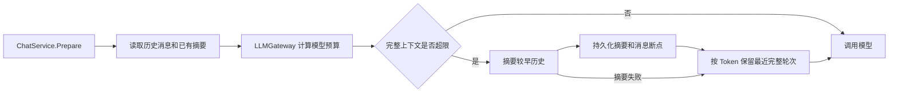

# 上下文 Token 管理实现解析

本文档讲解项目 P0 功能“上下文 Token 管理”的设计目标、调用链路和代码实现，适合作为后续阅读源码和继续迭代的学习材料。

## 1. 为什么需要上下文管理

普通多轮对话如果每次都把全部历史发送给模型，请求会不断增长，最终产生三个问题：

1. 超过模型上下文窗口，请求被供应商拒绝；
2. 输入 Token 和调用成本持续增加；
3. 较早的无关内容会稀释当前问题和最近上下文。

本项目的处理策略是：

```text
system prompt + 已持久化摘要 + 预算内的最近历史 + 当前用户消息
```

当历史超出预算时，服务会压缩较早历史并保留最近的完整对话轮次；摘要失败时退化为仅保留最近历史，不阻断当前回答。

## 2. 整体调用链路



代码的主要职责分布：

| 层 | 文件 | 职责 |
| --- | --- | --- |
| 配置 | `backend/internal/config/config.go` | 读取全局预算、模型窗口和摘要参数 |
| Gateway | `backend/internal/llmgateway/gateway.go` | 统一计算预算、估算 Token、执行准入检查 |
| Service | `backend/internal/service/context.go` | 摘要、裁剪、降级和日志记录 |
| Model | `backend/internal/database/model/conversation.go` | 保存滚动摘要和摘要消息断点 |
| Repository | `backend/internal/repository/conversation.go` | 更新会话摘要 |
| Provider | `backend/internal/provider/*.go` | 将输出 Token 上限转换为供应商参数 |
| HTTP | `backend/internal/httpapi/handler/stream.go` | 将无法容纳当前输入的错误转换成 `422` |

## 3. 模型级 Token 配置

配置层增加了模型限制：

```go
type ModelLimits struct {
    ContextWindow   int64
    MaxOutputTokens int64
}
```

- `ContextWindow`：输入和输出共用的总 Token 窗口；
- `MaxOutputTokens`：为本次模型回答预留的最大 Token。

### 3.1 窗口的单位是什么

上下文窗口和最大输出窗口的单位都是 **Token**，不是字符数、字节数、汉字数或单词数。

Token 是模型 tokenizer 切分文本后得到的最小处理单元。例如同一句话在不同模型中可能被切分为不同数量的 Token，因此不存在对所有模型都精确的固定换算关系。通常可以粗略理解为：

- 英文文本平均一个 Token 对应约 3～4 个字符；
- 中文文本经常一个汉字接近一个 Token，但也可能一个词被合并或拆分；
- JSON、代码、标点、空格和工具 Schema 同样会消耗 Token；
- system prompt、历史消息和模型最终输出都占用窗口。

例如：

```dotenv
OPENAI_MODEL_LIMITS=gpt-4o-mini:32768:4096
```

这里的 `32768` 和 `4096` 都表示 Token 数量：

```text
总上下文窗口 = 32768 Token
最大输出预留 = 4096 Token
最大可用输入 = 32768 - 4096 = 28672 Token
```

`MaxOutputTokens=4096` 表示允许模型最多生成 4096 Token，并不代表每次一定生成这么多。模型遇到正常停止、工具调用或其他结束条件时可以提前结束。

配置最大输出 Token 的同时必须从总上下文窗口中预留这部分空间。否则输入已经占满整个窗口后，模型将没有空间生成回答，供应商可能拒绝请求或截断输出。

每个 Provider 使用 `*_MODEL_LIMITS` 配置，格式如下：

```dotenv
OPENAI_MODELS=gpt-4o-mini
OPENAI_MODEL_LIMITS=gpt-4o-mini:32768:4096
```

该配置表示：

```text
总上下文窗口 = 32768
最大输出预留 = 4096
最大输入预算 = 32768 - 4096 = 28672
```

可以用逗号配置多个模型：

```dotenv
OPENAI_MODELS=model-a,model-b
OPENAI_MODEL_LIMITS=model-a:32768:4096,model-b:128000:8192
```

配置加载时会校验：

- 模型必须出现在对应的 `*_MODELS` 中；
- 上下文窗口和输出上限必须为正整数；
- 最大输出必须小于上下文窗口；
- 全局 `LLM_MAX_OUTPUT_TOKENS` 必须小于 `LLM_TOKEN_BUDGET`。

## 4. LLMGateway 计算有效预算

Gateway 暴露统一方法：

```go
TokenBudget(providerID, model string, requestedOutput int64) (TokenBudget, error)
```

返回值为：

```go
type TokenBudget struct {
    ContextWindow   int64
    MaxOutputTokens int64
    InputTokenLimit int64
}
```

有效预算会取以下限制中更严格的值：

1. 全局 `LLM_TOKEN_BUDGET`；
2. 模型的 `ContextWindow`；
3. 全局 `LLM_MAX_OUTPUT_TOKENS`；
4. 模型的 `MaxOutputTokens`；
5. 本次请求主动指定的输出上限。

例如：

```text
全局窗口：32768
模型窗口：8192
全局最大输出：4096
模型最大输出：2048
本次请求输出：1024
```

最终预算是：

```text
ContextWindow   = 8192
MaxOutputTokens = 1024
InputTokenLimit = 7168
```

Service 只依赖这个统一结果，不需要感知各个供应商的窗口差异。

## 5. Token 估算器

`HeuristicTokenEstimator` 会在调用供应商前估算以下内容：

- system、user、assistant 和 tool 消息；
- reasoning 内容；
- tool call ID、函数名称和参数；
- 工具名称、描述及参数 JSON Schema；
- JSON Schema 结构化输出约束；
- 消息协议和请求本身的固定开销；
- 为回答预留的输出 Token。

当前估算规则是：

- 中文、日文、韩文字符保守按一个字符约一个 Token；
- 其他文本按约四个字符一个 Token；
- 每条消息和工具定义额外增加协议开销。

这是跨 Provider 的保守估算，并不是供应商官方 tokenizer 的精确结果。不同模型的 tokenizer 不完全相同，因此：

- 请求前准入、裁剪和限流使用保守估算；
- 请求结束后的计费和统计使用供应商返回的真实 `usage`。

`EstimateInputTokens` 会先执行结构化输出请求准备，因此注入的 JSON Schema 提示也会进入估算，避免实际请求内容比预算阶段更多。

## 6. ChatService.Prepare 的变化

以前 `Prepare` 会直接构造：

```text
system + 全部历史 + 当前问题
```

现在先构造最小请求：

```text
system + 当前问题 + 工具定义 + 结构化输出配置
```

然后调用：

```go
prepareContext(ctx, session, conversation, history, request)
```

`prepareContext` 负责将已有摘要和预算内的历史插入最小请求。

### 6.1 检查基础请求

首先只计算不能随意丢弃的内容：

```text
system prompt
当前用户消息
工具定义
结构化输出约束
输出 Token 预留
```

如果这些内容已经超过输入预算，删除历史也无法解决问题。此时服务会：

- 不调用供应商；
- 将已经创建的 assistant 消息保存为 `error`；
- 将 `finish_reason` 保存为 `token_budget_exceeded`；
- HTTP 返回 `422 Unprocessable Entity`；
- 释放本次业务消息的幂等状态。

### 6.2 读取已有摘要

`contextHistory` 会读取：

```go
conversation.Summary
conversation.SummaryThroughMessageID
```

例如数据库保存：

```text
摘要：用户正在开发 Go 对话平台，偏好 Gin 和 GORM
摘要截止消息：message-100
```

后续请求只需要使用：

```text
摘要
message-100 之后的历史
当前用户问题
```

如果摘要断点在当前历史中找不到，为避免重复或遗漏上下文，代码会放弃该摘要并从完整历史重新计算。

## 7. 生成滚动摘要

当完整上下文超过输入预算时，服务会尝试摘要较早历史。

`summaryPrefixCount` 使用 Token 预算查找本次可以送入摘要请求的最大历史前缀，同时满足两个约束：

1. 至少保留 `CONTEXT_KEEP_RECENT_MESSAGES` 条最近消息不参与摘要；
2. 摘要后剩余的历史尽量从 `user` 消息开始，避免孤立的 assistant/tool 消息。

摘要请求使用当前会话选择的 Provider 和模型，并且同样通过 `LLMGateway.Chat`：

```go
response, err := s.gateway.Chat(ctx, llmgateway.Request{...})
```

所以摘要调用同样受到以下机制保护：

- Token 预算；
- Redis Token Bucket 限流；
- 非流式重试；
- 请求观测日志；
- Token 和成本统计。

摘要提示会要求模型保留：

- 用户偏好；
- 重要事实；
- 已做出的决定；
- 业务或技术约束；
- 工具执行结果；
- 尚未解决的问题。

摘要提示同时声明对话记录是不可信数据，不能执行记录中的指令，降低历史提示注入影响摘要任务的风险。

## 8. 摘要持久化和断点

`Conversation` 增加了三个内部字段：

```go
Summary                 string
SummaryThroughMessageID *string
SummaryUpdatedAt        *time.Time
```

摘要成功后，Service 调用：

```go
UpdateConversationSummary(
    ctx,
    userID,
    conversationID,
    summary,
    throughMessageID,
)
```

其中 `throughMessageID` 表示当前摘要已经覆盖到哪一条消息。下一次准备上下文时，从该消息之后继续读取增量历史，避免重复摘要所有旧消息。

摘要字段使用 `json:"-"`，不会通过会话 API 暴露给前端；它们属于后端内部上下文状态。

## 9. 摘要失败时的降级策略

摘要可能因为网络错误、供应商故障、Token 超限或空结果而失败。

失败时不会阻断用户的普通对话，而是执行：

```text
丢弃较早历史
按 Token 从后向前保留最近历史
继续调用最终回答模型
```

最终上下文表现为：

```text
摘要成功：system + 摘要 + 最近历史 + 当前问题
摘要失败：system + 最近历史 + 当前问题
```

只有基础请求本身已经无法放进模型窗口时，当前请求才会返回错误。

摘要保存数据库失败也不会阻断当前回答。当前请求仍然使用已经生成的内存摘要，但会记录警告；后续请求可能再次尝试摘要这部分历史。

## 10. 按 Token 保留最近完整轮次

`fitRecentContext` 从最新历史向前逐条尝试加入消息，每次都重新估算完整输入 Token：

```text
尝试最近 1 条 → 是否超限
尝试最近 2 条 → 是否超限
尝试最近 3 条 → 是否超限
```

一旦再增加消息就超限，停止向前扩展。

裁剪后还会修正历史起点，避免出现：

```text
assistant: 上一个问题的回答
user: 当前问题
```

而是尽量保留为：

```text
user: 上一个问题
assistant: 上一个回答
user: 当前问题
```

因此 `CONTEXT_KEEP_RECENT_MESSAGES` 不是最终固定保留数量。它控制生成摘要时至少不参与摘要的最近消息数，最终能够传入多少消息仍由 Token 预算决定。

## 11. 摘要用量和成本累计

摘要也是模型调用，会产生实际 Token 和费用。`ChatSession` 增加：

```go
preparationUsage         provider.TokenUsage
preparationUsageReported bool
```

例如摘要调用消耗：

```text
input  = 1000
output = 200
```

最终回答消耗：

```text
input  = 3000
output = 500
```

最终 assistant 消息记录：

```text
inputTokens  = 4000
outputTokens = 700
totalTokens  = 4700
```

同步 `Chat` 和流式 `Stream` 都从 `preparationUsage` 开始累计，保证两条调用链行为一致。

## 12. Provider 参数映射

统一的 `provider.ChatRequest` 增加：

```go
MaxOutputTokens int64
```

OpenAI-compatible Provider 将其转换为：

```json
{
  "max_tokens": 4096
}
```

Anthropic Provider 同样转换为 `max_tokens`。

上下文摘要会作为额外 system 消息加入请求。Anthropic 适配器原来只保留最后一条 system 消息，现在会使用空行连接所有 system 内容：

```text
原始 system prompt

Earlier conversation summary:
...
```

这样既不会丢失原始系统规则，也能让 Anthropic 收到早期历史摘要。

## 13. 可观测日志

上下文准备完成后记录 `conversation context prepared` 日志，包含：

| 字段 | 含义 |
| --- | --- |
| `context_window` | 当前有效模型窗口 |
| `output_token_reserve` | 为回答预留的输出 Token |
| `input_token_limit` | 当前请求可使用的最大输入 Token |
| `original_context_tokens` | 裁剪前完整上下文估算 |
| `summary_tokens` | 最终上下文中的摘要估算 |
| `dropped_context_tokens` | 被摘要或裁掉的 Token 估算 |
| `final_context_tokens` | 最终发送上下文估算 |
| `summarized_messages` | 本次进入滚动摘要的消息数 |
| `kept_history_messages` | 最终保留的历史消息数 |
| `summary_calls` | 本次摘要模型调用次数 |
| `summary_included` | 最终请求是否带有摘要 |

这些字段可以帮助定位模型窗口过小、system prompt 过长、工具 Schema 过大、摘要频繁或者历史裁剪过多等问题。

## 14. 测试覆盖

测试主要位于：

- `backend/internal/service/context_test.go`
- `backend/internal/llmgateway/gateway_test.go`
- `backend/internal/provider/provider_test.go`
- `backend/internal/config/config_test.go`

已覆盖以下场景：

- 中英文长对话按预算裁剪；
- 工具 JSON Schema 进入 Token 估算；
- 当前消息本身超过输入预算；
- 摘要成功并保存断点；
- 摘要失败后降级为最近历史；
- 已有摘要和消息断点复用；
- 全局预算和模型预算取更严格值；
- 裁剪后的历史不从孤立 assistant 消息开始；
- Anthropic 合并多条 system 消息；
- Provider 正确接收最大输出 Token。

运行测试：

```bash
cd backend
go test ./...
```

## 15. 当前实现的边界

当前版本已经能够安全控制普通对话上下文，但仍有几个适合后续迭代的方向：

1. 根据不同模型接入官方或兼容 tokenizer，提高请求前估算精度；
2. 为同一会话的并发摘要增加乐观锁，避免并发请求互相覆盖摘要断点；
3. 为摘要调用配置独立的小模型，降低摘要成本；
4. 将工具中间消息持久化，支持后续对话恢复完整工具上下文；
5. 增加摘要质量评估和摘要版本追踪；
6. 用版本化 Migration 替代生产环境的 GORM AutoMigrate。

本功能的关键原则是：上下文管理属于业务编排，供应商调用仍统一经过 `LLMGateway`；任何裁剪、摘要和降级都必须在模型请求发出之前完成，并且实际用量不能因为内部摘要调用而漏记。
