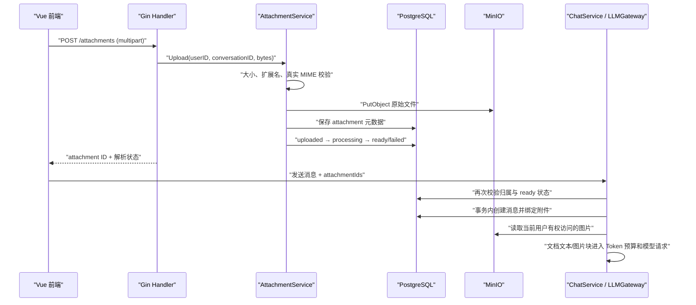

# 图片和文件上传实现解析

本文对应 `TODO.md` 第 6 项。目标不只是增加上传接口，而是建立一条可校验、可授权、可恢复、可清理，并能安全进入模型上下文的附件链路。

## 1. 为什么拆成上传和发送两个阶段

浏览器先通过 multipart 接口上传文件，服务端完成对象存储、格式识别和文本解析；用户真正点击发送时，消息请求只携带附件 ID。



这样设计有三个直接收益：

1. 大文档解析失败不会创建残缺的聊天消息，用户可以先重试或移除。
2. 消息接口不需要携带 Base64 大请求体，重连和幂等边界更清晰。
3. 服务端可以在发送时重新检查附件归属，不能相信前端传来的 ID。

## 2. 数据模型与对象存储边界

`attachments` 表保存用户、会话、消息归属，原文件名、扩展名、实际 MIME、大小、对象 key、解析状态、错误信息和提取文本。原始二进制放入 MinIO，不写入 PostgreSQL。

`message_id` 在上传阶段为空，发送消息时才赋值。一个附件只能从“当前用户、当前会话、尚未绑定、状态为 ready”这一集合中被认领。

`attachment_chunks` 目前只预留分块序号、文本、Token 数和 Embedding 状态，没有提前引入 pgvector。以后做 RAG 时可以增加 `vector` 列和索引，而不必修改上传与权限模型。

## 3. 为什么权限校验必须做两次

上传时，`AttachmentService` 先用 `conversation_id + user_id` 查询会话，避免把附件挂到别人的会话。

发送时，`CreateTurnWithAttachments` 在创建 user/assistant 消息的同一个数据库事务中执行条件更新：

```sql
UPDATE attachments
SET message_id = :user_message_id
WHERE id IN (:attachment_ids)
  AND user_id = :current_user
  AND conversation_id = :conversation
  AND message_id IS NULL
  AND status = 'ready';
```

只有更新行数与去重后的附件 ID 数完全相同，事务才提交。这同时阻止 UUID 猜测越权、跨会话引用、解析未完成使用和两个并发请求重复认领。

下载接口也按 `user_id + conversation_id + attachment_id` 查询，不暴露永久公网 URL。模型只能拿到通过这条权限链读出的内容。

## 4. 文件校验与解析状态

当前白名单为 PNG、JPG/JPEG、GIF、WebP、TXT、PDF 和 DOCX。只看浏览器提交的 `Content-Type` 或文件扩展名都不安全，因此服务端组合校验：

- 配置的单文件大小上限，默认 10 MiB；
- 白名单扩展名；
- `http.DetectContentType` 得到的文件头 MIME；
- DOCX 必须是有效 ZIP 且包含 `word/document.xml`；
- TXT 必须是有效 UTF-8；
- WebP 必须具有 RIFF/WEBP 文件头。

附件状态流转如下：

```text
uploaded → processing → ready
                      ↘ failed → retry → processing
```

TXT 直接读取；DOCX 解压并解析 WordprocessingML 的文字节点；PDF 使用本地解析器提取可选择文本。扫描版 PDF 没有文字层，目前不会偷偷当成成功，而是保存 `no_extractable_text`，前端提示“暂不支持 OCR”并保留重试入口。

`ATTACHMENT_MAX_TEXT_CHARS` 限制进入上下文的提取文本，防止单个文档无限膨胀。后续大文档应改成分块检索，而不是不断提高这个值。

## 5. 图片如何适配不同模型协议

业务层使用统一 `provider.ContentPart`，不会直接拼供应商 SDK 请求：

- OpenAI-compatible 转换为 `content[]` 中的 `image_url`，内容是 `data:<mime>;base64,...`；
- Anthropic 转换为 `content[]` 中的 `image` 与 `source.type=base64`。

每个 Provider 通过 `*_VISION_MODELS` 明确配置支持图片的模型。模型目录把 `visionModels` 返回前端用于即时提示，服务端仍会最终校验。不能通过“模型名称里包含 vision”猜能力，因为兼容端点、版本和部署能力可能不同。

文档提取文本会用明确的附件边界追加到当前 user 输入，因此会进入现有上下文 Token 估算、裁剪和限流。图片暂按每张 1200 Token 做保守准入预留，最终计费仍以供应商 usage 为准。

重新生成已有图片问题时，会从受权限保护的消息附件重新读取对象并构造相同视觉输入，不需要重新上传。

## 6. 前端交互

`ChatPanel.vue` 支持三种入口：文件按钮、拖拽到输入框、在输入框粘贴剪贴板图片。所有方式复用同一个上传函数。

上传和解析期间显示状态；失败原因紧邻附件并用 `role="alert"` 通知辅助技术；失败附件有“重试”和“移除”两个恢复路径。按钮保留至少 44×44 像素点击区域，图标使用统一线性 SVG，不依赖 hover 或颜色表达状态。

存在上传中、解析失败或视觉能力不匹配的附件时，发送按钮会禁用。切换会话会清理尚未绑定的附件，防止对象存储长期积累草稿文件。

## 7. 删除与一致性取舍

删除会话前先列出对象 key，数据库级联删除消息和附件行成功后，再删除 MinIO 对象。消息与账号删除功能尚未开放 HTTP 入口，后续应复用同一 `AttachmentService` 清理边界。

当前“数据库删除成功、MinIO 删除短暂失败”可能产生孤儿对象。生产环境更稳妥的做法是写入 outbox/删除任务，由后台任务重试并定期扫描孤儿对象，而不是让用户删除会话因为对象存储抖动而失败。

## 8. 关键配置

```dotenv
OBJECT_STORAGE_ENDPOINT=localhost:9000
OBJECT_STORAGE_ACCESS_KEY=agent_minio
OBJECT_STORAGE_SECRET_KEY=agent_minio_password
OBJECT_STORAGE_BUCKET=chat-attachments
OBJECT_STORAGE_REGION=us-east-1
OBJECT_STORAGE_USE_SSL=false
ATTACHMENT_MAX_BYTES=10485760
ATTACHMENT_MAX_COUNT=5
ATTACHMENT_MAX_TEXT_CHARS=200000
OPENAI_VISION_MODELS=gpt-4o-mini
QWEN_API_KEY=你的百炼APIKey
QWEN_BASE_URL=https://dashscope.aliyuncs.com/compatible-mode/v1
QWEN_MODELS=qwen3-vl-flash
QWEN_VISION_MODELS=qwen3-vl-flash
```

本地执行 `docker compose up -d` 会同时启动 PostgreSQL、Redis 和 MinIO；MinIO API 默认是 `localhost:9000`，管理控制台是 `localhost:9001`。

## 9. 后续扩展路线

1. 将同步解析改为持久化任务队列，避免大文档占用 HTTP 请求。
2. 增加图片像素/解压膨胀限制、恶意文件扫描和租户级存储配额。
3. 为扫描 PDF 增加受限 OCR worker。
4. 按语义边界分块，使用模型对应 tokenizer 记录精确 Token。
5. 写入 pgvector Embedding，查询时始终带 `user_id/workspace_id` 权限条件。
6. 用 outbox 和定时回收任务保证对象删除最终一致。

## 10. 验证重点

后端测试覆盖扩展名/MIME 不一致、UTF-8 TXT、DOCX 结构与文本提取，以及 OpenAI/Anthropic 两种图片协议映射。还应在集成环境验证：猜测其他用户附件 ID 返回 404、同一附件并发发送只成功一次、扫描 PDF 显示可恢复错误、删除会话后 MinIO 对象消失。
