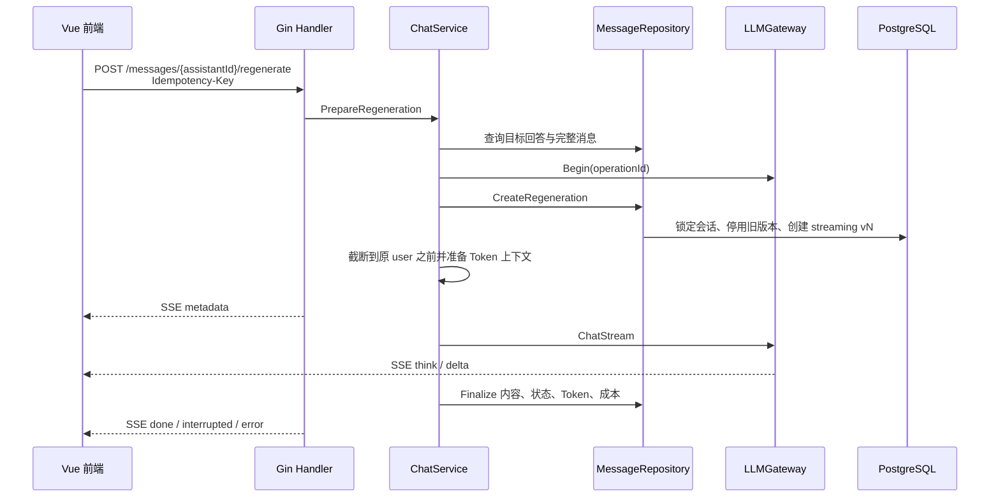

# 重新生成回答实现解析

本文档讲解项目 P0 功能“重新生成回答”的设计目标、数据结构、调用链路和关键代码，适合作为阅读源码及继续迭代对话分支功能的学习材料。

## 1. 重新生成不等于再次发送问题

最简单的实现是把原问题再次提交给普通消息接口，但这会产生两个错误：

1. 数据库多出一条重复的 user 消息；
2. 模型可能收到旧回答和后续对话，生成结果不再是对原问题的另一种回答。

本项目将重新生成定义为：

```text
复用原 user 消息
+ 只加载原 user 之前的上下文
+ 创建新的 assistant 版本
+ 保留所有旧 assistant 版本
```

因此重新生成是一种独立的业务操作，而不是普通发送接口的前端快捷方式。

## 2. 整体调用链路



主要职责分布：

| 层 | 文件 | 职责 |
| --- | --- | --- |
| Model | `backend/internal/database/model/message.go` | 保存回答归属、版本、激活状态和重新生成来源 |
| Repository | `backend/internal/repository/message.go` | 事务内创建新版本、切换激活版本、保证并发一致性 |
| Service | `backend/internal/service/chat.go` | 校验目标回答、截断上下文、编排幂等与模型调用 |
| Context | `backend/internal/service/context.go` | 只把激活的回答版本送给模型 |
| Handler | `backend/internal/httpapi/handler/stream.go` | 提供重新生成 SSE API并复用流式终态处理 |
| Frontend API | `frontend/src/lib/api.ts` | 发起重新生成和版本切换请求 |
| Frontend State | `frontend/src/App.vue` | 管理 AbortController、流式增量和激活版本 |
| Frontend UI | `frontend/src/components/ChatPanel.vue` | 显示重新生成按钮和回答版本导航 |

## 3. 消息版本数据结构

assistant 消息新增以下字段：

```go
ReplyToMessageID *string
ResponseVersion  int64
IsActiveResponse bool
RegeneratedFrom  *string
GenerationKey    *string
```

字段含义：

- `ReplyToMessageID`：当前 assistant 回答的是哪一条 user 消息，也是回答版本组的标识；
- `ResponseVersion`：同一个问题下从 1 开始递增的版本号；
- `IsActiveResponse`：当前对话选中了哪个回答版本；
- `RegeneratedFrom`：本次重新生成是从哪个 assistant 触发的，便于审计和分析；
- `GenerationKey`：完整业务操作的幂等键，数据库唯一索引用于阻止重复创建。

例如：

```text
user-100  “解释一下 Tool Calling”
  ├─ assistant-101  version=1 active=false
  ├─ assistant-102  version=2 active=true
  └─ assistant-103  version=3 active=false
```

切换版本只修改 `IsActiveResponse`，不会覆盖任何版本的正文、思考内容、状态、Token 或成本。

### 3.1 为什么现在不用 parent_message_id

`ReplyToMessageID` 只表达“这些 assistant 都在回答同一个 user”，足以完成重新生成。完整的 `parent_message_id` 还需要表达编辑历史消息后产生的多条对话分支，属于 TODO 第 3 项。

先使用回答版本组，可以避免在尚未实现分支选择、分支查询和分支上下文前，引入一个语义不完整的树结构。

## 4. 普通回答如何建立关联

普通发送仍由 `CreateTurn` 原子创建 user 和 assistant。在 user 插入并获得 UUID 后，Repository 设置：

```go
assistantMessage.ReplyToMessageID = &userMessage.ID
assistantMessage.ResponseVersion = 1
assistantMessage.IsActiveResponse = true
```

这样新旧两条消息仍处于同一个事务中，不会出现 user 已保存但 assistant 占位消息缺失的半完成状态。

## 5. PrepareRegeneration 如何截断上下文

`ChatService.PrepareRegeneration` 先确认：

1. 会话属于当前用户；
2. 目标消息属于该会话；
3. 目标角色是 assistant；
4. 目标回答不处于 `streaming`；
5. Provider、模型、temperature 和结构化输出配置有效。

然后通过 `ReplyToMessageID` 找到原 user。对于升级前没有关联字段的历史数据，会向前查找最近一条 user 作为兼容降级。

假设原会话是：

```text
user-1 -> assistant-1
user-2 -> assistant-2  <- 对它重新生成
user-3 -> assistant-3
```

重新生成请求只会收到：

```text
system
user-1
当前激活的 assistant-1
user-2
```

以下内容不会进入请求：

- 旧的 `assistant-2`；
- `user-3` 和 `assistant-3`；
- 同一个问题的其他回答版本。

这保证了新回答确实是站在原问题发生时重新回答。

### 5.1 为什么不复用已有滚动摘要

会话摘要可能已经覆盖 `assistant-2`、`user-3` 等更晚消息。如果在重新生成历史回答时直接复用摘要，会把“未来信息”泄漏给模型。

所以重新生成会清空本次内存中的摘要引用，再针对原 user 之前的精确消息前缀执行现有 Token 管理。历史前缀在本次请求中产生的摘要不会覆盖会话的全局滚动摘要。

创建新回答版本或切换激活版本后，Repository 还会让已有会话摘要失效。原因是旧摘要可能包含之前激活的回答；继续使用会让模型同时看到摘要里的旧版本和原文里的新版本。下一次普通对话会基于当前激活版本重新生成需要的摘要。

## 6. 创建新版本为什么必须使用事务

`CreateRegeneration` 在一个 PostgreSQL 事务内执行：

1. `FOR UPDATE` 锁定所属会话；
2. 检查 `GenerationKey` 是否已经存在；
3. 读取目标 assistant；
4. 计算同一 `ReplyToMessageID` 下的最大版本号；
5. 将该版本组全部设为非激活；
6. 创建 `version + 1` 的 streaming assistant；
7. 更新会话时间。

锁定会话而不是仅锁定某个回答，是因为用户可能分别从 v1 和 v2 同时触发重新生成。如果只锁两条不同的 assistant 行，两个事务仍可能同时计算出相同的下一个版本号。

## 7. 三层防重复机制

重新生成使用三层保护：

### 7.1 前端生成状态

同一个会话存在进行中的 `AbortController` 时，重新生成按钮和版本切换按钮会禁用，重复点击不会发出请求。

### 7.2 LLMGateway 幂等状态

前端为每次操作生成 `Idempotency-Key`。Service 将用户、会话、目标回答和该键组合成 `operationId`：

```text
userId:conversationId:targetAssistantId:idempotencyKey
```

Gateway 的 `Begin` 会在整次业务消息外层加锁。内部供应商重试属于同一个 operation，不会被误判成新的业务消息。

### 7.3 数据库 GenerationKey

新 assistant 会保存同一个 operationId，并建立唯一索引。即使进程重启导致内存幂等状态丢失，重复请求也会在创建回答版本时停止，不会进入模型调用。

当前 Gateway 的幂等存储仍是内存实现；TODO 的“多实例共享状态”会进一步将它迁移到 Redis。

## 8. 停止生成和异常终态

重新生成与普通发送共用 `streamPreparedSession` 和 `ChatService.Stream`，因此自动继承已有能力：

- 用户点击“停止生成”时，前端调用 `AbortController.abort()`；
- fetch 请求上下文取消后，Gin 的 `Request.Context()` 结束；
- Service 取消 LLMGateway 和供应商 HTTP 流；
- assistant 保存为 `stopped`；
- 已产生的内容、Token 和成本按现有终态逻辑落库；
- 断流、TTFT 超时和总时长超时保存为 `interrupted`；
- SSE 缓存继续使用 assistant messageId 和递增 sequence 支持短期补发。

因为重新生成的 assistant 从 metadata 阶段就拥有独立 messageId，它不会与旧版本的 SSE 事件混合。

## 9. Token、成本和重新生成次数如何记录

每个回答版本都是独立的 `messages` 记录，因此已有字段会分别保存：

```text
input_tokens
output_tokens
total_tokens
cost_nano_usd
usage_reported
cost_known
finish_reason
status
```

重新生成次数无需维护一个容易并发失真的计数器，可以由版本号得到：

```text
regeneration_count = response_version - 1
```

结构化日志额外记录：

```text
is_regeneration
response_version
provider
model
status
finish_reason
input_tokens
output_tokens
total_tokens
cost_nano_usd
```

因此可以按单次版本审计费用，也可以按 `ReplyToMessageID` 聚合一个问题的全部重新生成成本。

## 10. 前端如何把版本显示在原位置

数据库按创建时间返回所有消息。如果直接渲染，后来创建的 v2 会出现在会话末尾。

`ChatPanel` 会先按 `replyToMessageId` 聚合 assistant，再在该版本组第一次出现的位置渲染当前激活版本。后端 `contextHistory` 也执行同样的逻辑顺序重排，避免较晚创建的新版本被放到后续对话之后：

```text
原 user
当前激活 assistant   [‹ 1 / 3 ›] [重新生成]
后续 user
```

切换箭头调用激活版本 API；重新生成完成后，新版本立即成为激活版本。所有旧版本仍保留在前端消息集合中，因此切换不需要重新请求正文。

## 11. API

### 11.1 重新生成回答

```http
POST /api/v1/conversations/{conversationID}/messages/{assistantMessageID}/regenerate
Authorization: Bearer <token>
Idempotency-Key: <uuid>
Accept: text/event-stream
Content-Type: application/json

{
  "provider": "deepseek",
  "model": "deepseek-chat"
}
```

响应沿用普通生成的 SSE 事件：

```text
metadata -> think/delta -> done|interrupted|error
```

### 11.2 切换回答版本

```http
PATCH /api/v1/conversations/{conversationID}/messages/{assistantMessageID}/activate
Authorization: Bearer <token>
```

服务端会在事务内取消同组旧激活状态并激活目标版本。

## 12. 当前边界与后续演进

本功能解决的是“同一个 user 问题拥有多个 assistant 回答”，还没有实现完整对话树。当前需要理解以下边界：

- 切换较早回答后，数据库中更晚的消息不会自动形成独立分支；
- 编辑 user 消息尚未实现；
- 多实例 Gateway 幂等状态和 SSE 缓存仍需迁移到 Redis；
- 生产环境应使用版本化 Migration 替代 AutoMigrate。

TODO 第 3 项会在此基础上加入 `parent_message_id` 或等价分支结构，使后续消息明确属于某一条回答路径。

## 13. 验证方式

后端测试重点验证：

- 重新生成复用原 user 消息；
- 请求上下文只到原 user 为止；
- 新 assistant 的版本号递增并记录来源；
- 非激活回答不会进入普通模型上下文。

前端构建用于检查 Vue 模板和 TypeScript 类型。手工验收建议：

1. 完成至少两轮对话；
2. 对第一轮回答点击“重新生成”；
3. 生成中点击停止，确认状态变为 stopped 且供应商请求取消；
4. 再次重新生成，确认显示 `2 / 3` 等版本数；
5. 来回切换版本，刷新页面后确认选中版本保持；
6. 检查数据库中各版本的内容、状态、Token 和成本均独立保存。
