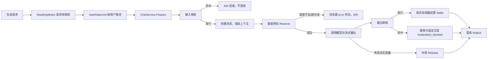

# 用户额度、并发与内容安全实现解析

本文档讲解项目 P1 功能“用户额度、并发和内容安全”的设计目标、调用链路和代码实现，适合作为后续阅读源码和继续迭代的学习材料。

## 1. 为什么需要这一层

开放注册的多用户对话产品，如果任何请求都直接打到模型供应商，会遇到三类事故：

1. **成本失控**：单个用户可以无限发起长上下文请求，Token 费用没有上限；
2. **服务能力被独占**：单个用户开几十个并发生成，其他用户全部排队；
3. **合规风险**：违规输入进入模型、违规输出直接展示给用户。

本项目的处理策略是把准入控制拆成四个相互独立的机制，各司其职：

| 机制 | 关心的问题 | 位置 |
| --- | --- | --- |
| Rate Limit（限流） | 单位时间内的请求次数，防瞬时洪峰和刷接口 | 中间件 `middleware/guard.go`，Redis 固定窗口 |
| Quota（额度） | 累计 Token 用量，控制成本 | `service/quota.go` + `repository/quota.go`，PostgreSQL |
| 并发生成限制 | 同时在飞的生成请求数，防止独占服务能力 | 额度预扣事务内统计 `streaming` 消息 |
| 内容审核 | 输入/输出合规 | `moderation` 包，输入拦截 + 输出替换 |

三者经常一起出现但语义不同：限流拒绝的是“太快”，额度拒绝的是“用太多”，并发拒绝的是“同时太多”。限流窗口结束后用户可以继续请求；额度用完只能等窗口滚动或管理员调整；并发等其中一个请求结束就释放。

## 2. 整体调用链路



代码的主要职责分布：

| 层 | 文件 | 职责 |
| --- | --- | --- |
| 配置 | `backend/internal/config/config.go` | 额度默认值、限流窗口、大小限制、审核词表等 |
| 中间件 | `backend/internal/httpapi/middleware/guard.go` | 请求体大小、按用户限流 |
| 中间件 | `backend/internal/httpapi/middleware/admin.go` | 管理员角色鉴权 |
| Service | `backend/internal/service/quota.go` | 预扣、结算、补偿的业务入口 |
| Service | `backend/internal/service/admin.go` | 封禁/解封、额度调整、审计 |
| Service | `backend/internal/service/chat.go` | 准入编排：审核、预扣、结算、告警 |
| Repository | `backend/internal/repository/quota.go` | 行锁事务、窗口滚动、并发统计 |
| Model | `backend/internal/database/model/user_quota.go` | 额度与用量持久化 |
| 审核 | `backend/internal/moderation/moderation.go` | 可替换的审核策略接口 |
| 工具 | `backend/internal/tool/tool.go` | 工具权限、参数审计、超时、大小限制 |
| 告警 | `backend/internal/alerting/alerting.go` | 运营告警统一出口 |

## 3. 额度的预扣-结算-补偿模型

### 3.1 为什么不能事后扣费

如果等请求完成再按实际用量扣额度，两个并发请求会各自看到“额度充足”，最终双双超支。反过来，如果只按估算值扣费不结算，估算普遍偏保守，用户会白白损失额度。因此采用两阶段：

1. **预扣（Reserve）**：请求准入时按 `估算输入 Token + 模型最大输出预留` 扣减；
2. **结算（Settle）**：请求结束时退回预扣值、记入供应商上报的实际用量；
3. **补偿（Release）**：请求失败且没有任何用量上报时，全额退回预扣。

`ChatService` 中的对应实现：

```go
func (s *ChatService) settleQuota(session *ChatSession, usageData *model.MessageUsage, status string) {
    switch {
    case usageData.UsageReported:
        // 有实际用量：按实际结算
        s.quotas.Settle(ctx, session.UserID, session.quotaReservedTokens, usageData.TotalTokens)
    case status == "complete":
        // 回答完成但用量未知：按预扣值结算，宁可多扣不漏扣
        s.quotas.Settle(ctx, session.UserID, session.quotaReservedTokens, session.quotaReservedTokens)
    default:
        // 失败且无用量：补偿预扣额度
        s.quotas.Release(ctx, session.UserID, session.quotaReservedTokens)
    }
}
```

结算刻意使用独立的短超时上下文（`context.Background()` + 5s），客户端断开或服务端超时不会让预扣永久泄漏。

### 3.2 一致性如何保证

额度行在事务内用 `SELECT ... FOR UPDATE` 行锁串行化同一用户的所有预扣、结算和补偿：

```go
func lockOrCreateQuota(tx *gorm.DB, userID string, now time.Time) (*model.UserQuota, error) {
    err := tx.Clauses(clause.Locking{Strength: "UPDATE"}).Where("user_id = ?", userID).First(&quota).Error
    // 首次访问时创建零值行；并发首访冲突时重新加锁读取
}
```

两个并发预扣不可能同时看到“剩余额度足够”再双双通过。失败和重试场景下的行为：

| 场景 | 结果 |
| --- | --- |
| 模型调用失败、无用量 | Release 全额补偿 |
| 客户端中途取消、有用量 | Settle 按实际上报用量结算 |
| 客户端中途取消、无用量 | Release 补偿 |
| 完成但供应商未上报用量 | Settle 按预扣值结算（保守） |
| 结算本身失败 | 记录 ERROR 日志；窗口滚动后预扣自然清零 |

### 3.3 窗口滚动：不需要定时任务

`user_quota` 行上保存用量所属的自然日/自然月标记：

```go
type UserQuota struct {
    DailyUsedTokens   int64
    MonthlyUsedTokens int64
    DailyWindowDate   string // 例如 2026-08-13
    MonthlyWindowDate string // 例如 2026-08
}
```

每次读取时发现跨窗口就把用量归零并更新标记。没有后台定时任务，也不存在“零点重置”的惊群写入。

### 3.4 管理员覆盖值

`DailyTokenLimit` / `MonthlyTokenLimit` 是管理员覆盖值，与部署默认值的合并规则：

- `0`：沿用 `QUOTA_DEFAULT_DAILY_TOKENS` / `QUOTA_DEFAULT_MONTHLY_TOKENS`；
- 正数：显式额度；
- `-1`：该方向不限量。

## 4. 并发生成限制

并发的“在飞请求数”直接以数据库中 `status = 'streaming'` 的助手消息为准，在额度预扣的同一个事务里统计：

```go
tx.Model(&model.Message{}).
    Joins("JOIN conversations ON conversations.id = messages.conversation_id").
    Where("conversations.user_id = ? AND messages.status = ?", userID, "streaming").
    Count(&active)
```

选择这个口径的原因：

1. 消息在预扣之前就已创建为 `streaming`，当前请求自己也被计入，允许条件是 `active <= 上限`；
2. 进程崩溃留下的残留 `streaming` 消息会占用名额，但这恰好与“该用户的生成能力确实被占用”一致，且后续迭代（多实例共享状态）会负责修复残留消息；
3. 行锁已经串行化了同一用户的判断，不需要额外的分布式锁。

## 5. 大小限制矩阵

| 维度 | 配置 | 位置 |
| --- | --- | --- |
| 生成类接口请求体 | `CHAT_BODY_MAX_BYTES` | `middleware.MaxBodyBytes`，超限 `413` |
| 单条用户消息字符数 | `MESSAGE_MAX_CHARS` | `ChatService.Prepare` |
| 结构化输出 Schema | 64 KiB | `llmgateway/structured_output.go`（既有） |
| 工具调用参数 | `TOOL_ARGUMENT_MAX_BYTES` | `tool.Registry.ExecuteForUser` |
| 工具执行结果 | `TOOL_RESULT_MAX_BYTES` | 超出截断后再回传模型 |
| 附件大小与数量 | `ATTACHMENT_MAX_*` | 附件服务（既有） |

请求体超限通过 `http.MaxBytesReader` 让读取失败，handler 识别 `*http.MaxBytesError` 后返回 `413`，避免把几十 MB 的 JSON 完整读进内存。

## 6. 内容审核

`moderation.Moderator` 是可替换接口，当前实现是大小写不敏感的关键词策略：

- **输入审核**在用户消息落库和调用模型之前执行。命中直接返回 `403`，不创建任何消息，不产生任何模型费用；
- **输出审核**在流结束、落库之前执行。命中时丢弃模型原文（包括推理内容和结构化输出），替换为固定提示文案，`finish_reason` 标记为 `moderation_blocked`。前端无需特殊处理，消息正常展示提示文案。

两个方向的词表独立配置（`MODERATION_INPUT_BLOCKLIST` / `MODERATION_OUTPUT_BLOCKLIST`），因为输入侧要拦截的是“要求模型做坏事”，输出侧要拦截的是“模型真的输出了违规内容”，两者词表往往不同。

接入第三方审核服务时只需要实现 `Moderator` 接口并在 `server.go` 中替换注入，业务层不需要改动。

## 7. 工具调用的权限、审计和超时

`tool.Registry.ExecuteForUser` 是模型工具调用的唯一执行入口，按顺序执行：

1. **权限检查**：`tool.Policy` 接口判断用户是否有权调用该工具。默认 `AllowAllPolicy` 全部放行；`RolePolicy` 支持把指定工具配置为管理员专属（`TOOL_ADMIN_ONLY`）；
2. **参数大小限制**：模型构造的超大参数在执行前就被拒绝；
3. **超时控制**：每次执行包一层 `context.WithTimeout`，单个工具不会拖住整条生成链路；
4. **结果截断**：超大结果截断后才回传模型，保护后续轮次的上下文预算；
5. **参数审计**：输出结构化日志，记录用户、工具名、参数字节数和参数内容摘要（SHA-256 前 8 字节），不直接记录参数原文，避免把用户数据无限制写进日志。

被策略拒绝的工具调用不会中断对话：错误会作为 tool 结果返回给模型，模型可以向用户解释能力不可用。

## 8. 管理员运营能力

用户模型新增 `role` 和 `banned_at` 两个字段：

- **角色**：`ADMIN_EMAILS` 中的邮箱在注册或登录时自动提升为管理员，用于部署初期引导首个管理员账号；
- **封禁**：`PATCH /api/v1/admin/users/:userID/ban` 会设置 `banned_at` 并撤销该用户全部设备会话。封禁立即生效依赖两处检查：登录和刷新令牌时直接拒绝；`IsSessionActive` 联表检查 `users.banned_at IS NULL`，存量 Access Token 在下一次请求校验时就失效；
- **额度调整**：`PATCH /api/v1/admin/users/:userID/quota` 写入覆盖值；
- **审计**：所有管理员操作写入 `account_audit_logs`，metadata 中记录执行管理员 ID 和原因。

管理员路由统一挂在 `/api/v1/admin` 分组下，经过 `RequireAdmin` 中间件。鉴权查询失败按非管理员处理，宁可拒绝也不放行。

普通用户可以通过 `GET /api/v1/account/quota` 查询自己的额度快照。

## 9. 运营告警

`alerting.Alerter` 是告警的统一出口，默认实现输出带 `alert_kind` 字段的 ERROR 级结构化日志，日志管道按该字段即可配置通知规则。当前接入的告警：

| alert_kind | 触发点 | 含义 |
| --- | --- | --- |
| `cost_anomaly` | 单条消息结算后成本超过 `ALERT_COST_THRESHOLD_NANO_USD` | 可能是超长上下文或异常调用 |
| `call_surge` | 用户触发对话限流 | 可能是脚本刷接口 |
| `moderation_hit` | 输入或输出命中审核词表 | 需要人工复核的合规事件 |
| `quota_exhausted` | 额度或并发预扣被拒绝 | 观察用户是否持续撞额度 |

告警刻意不返回错误、不阻塞主流程：告警渠道故障时业务请求照常完成。

## 10. 错误码约定

| 场景 | HTTP 状态 | 提示 |
| --- | --- | --- |
| 请求体超限 | 413 | 请求内容超过大小限制 |
| 输入命中审核 | 403 | 内容可能包含敏感信息，无法发送 |
| 日额度耗尽 | 429 | 今日额度已用完，请明天再试 |
| 月额度耗尽 | 429 | 本月额度已用完，请下月再试 |
| 并发超限 | 429 | 同时生成的请求过多，请等待当前回答完成 |
| 账号被封禁 | 403 | 账号已被封禁，如有疑问请联系管理员 |

额度拒绝时，已创建的助手消息会以 `error` 终态落库，`finish_reason` 为 `quota_exceeded` 或 `concurrency_limit`，保证会话树中不残留 `streaming` 消息。

## 11. 测试策略

- `service/quota_test.go`：预扣/结算/补偿的语义和错误映射；
- `service/chat_safety_test.go`：输入拦截、额度拒绝落库终态、按实际用量结算、失败补偿、输出替换；
- `repository/quota_integration_test.go`：真实 PostgreSQL 下的行锁预扣、窗口滚动、管理员覆盖和 streaming 消息并发统计（需要 `TEST_DATABASE_URL`）；
- `tool/safety_test.go`：参数超限、结果截断、执行超时和策略拒绝；
- `httpapi/middleware/guard_test.go`：限流拒绝、故障放行、请求体超限和管理员鉴权；
- `moderation/moderation_test.go`：方向隔离、大小写不敏感和空策略放行。

## 12. 已知边界与后续迭代

1. **残留 streaming 消息占用并发名额**：依赖后续“多实例共享状态”迭代修复残留消息；
2. **额度按 Token 计**：金额额度可在 `user_quota` 上扩展同构字段，用同一套预扣-结算模型；
3. **关键词审核只是第一层防线**：生产环境应替换为语义级审核服务，接口已经预留；
4. **管理员接口尚无管理页面**：当前通过 API 调用，运营页面属于“指标、Trace 与运营”迭代。
